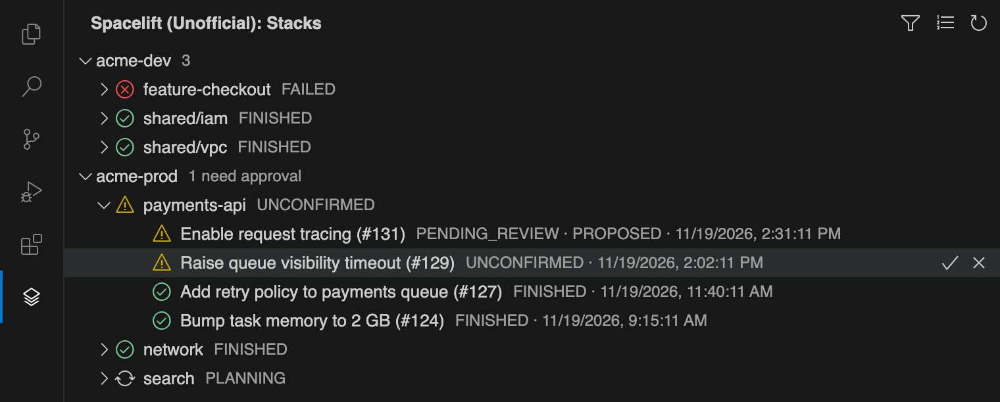
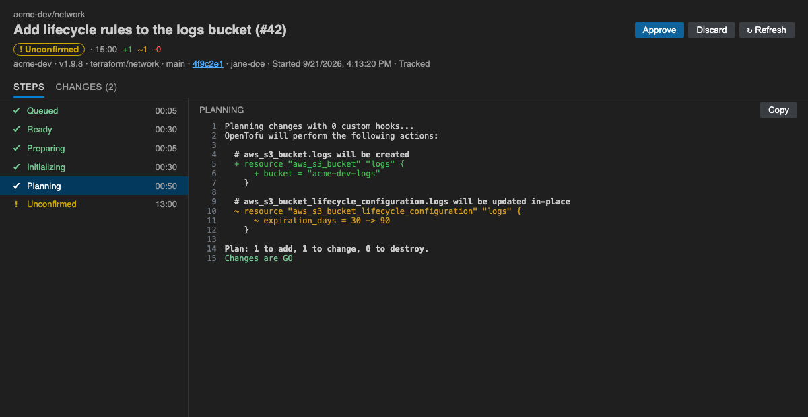

# Stacks for Spacelift (Unofficial)

Browse your [Spacelift](https://spacelift.io) stacks and runs, read plan and apply logs, and approve or discard runs without leaving VS Code.

> **Unofficial community project.** Not affiliated with, endorsed by, or supported by Spacelift, Inc. See [Disclaimer](#disclaimer).





## Features

- **Stacks view** in the activity bar, grouped by space, with live state icons. Stacks waiting for approval are flagged.
- **Filter and sort** from the view title: presets (needs approval, failed), free-text filter over name, space and state, and sorting by name, attention or recent change.
- **Run details** panel: status, commit, trigger, Terraform version and change counts, a step-by-step timeline (queued, planning, applying, ...), and the log of each step with colored errors, warnings and plan diffs.
- **Changes tab** listing every resource the run adds, changes, replaces or deletes.
- **Approve and Discard** for runs waiting for confirmation, from the panel or the run's context menu.
- **Approve and Reject reviews** for runs that need sign-off from an approval policy, including proposed (pull request) runs in `PENDING_REVIEW`. Proposed runs only appear in the tree while they await review.
- Logs and status refresh automatically while a run is in progress.

## Requirements

- VS Code 1.100 or newer.
- [`spacectl`](https://github.com/spacelift-io/spacectl), the Spacelift CLI (see below).
- A Spacelift account. The extension acts with your permissions, so you can only see and approve what Spacelift lets you.

### Installing spacectl

| OS | How |
| --- | --- |
| macOS | `brew install spacelift-io/spacelift/spacectl` |
| Windows | `winget install --id spacelift-io.spacectl`, or download the binary from the [releases page](https://github.com/spacelift-io/spacectl/releases) |
| Linux | Homebrew (same command as macOS), asdf, or download the binary from the [releases page](https://github.com/spacelift-io/spacectl/releases). Community packages exist for Arch (`yay -S spacectl-bin`) and Alpine (`apk add spacectl --repository=https://dl-cdn.alpinelinux.org/alpine/edge/testing`). Review community packages before installing. |

The setup flow below offers to run the install command on macOS and Windows, and opens the install guide on Linux.

- **Windows:** restart VS Code after installing so it picks up the updated `PATH`. If you point `spacelift.spacectlPath` at the binary yourself, use the `.exe`. The extension starts it directly, without a shell, so `.cmd` or `.bat` wrappers do not work.
- **Linux and macOS:** if `spacectl` is installed but VS Code cannot find it (common when VS Code is launched from a desktop launcher with a minimal `PATH`), set `spacelift.spacectlPath` to the full path, for example `/home/you/.local/bin/spacectl`.

## Getting started

1. Open the layers icon in the activity bar and click **Set Up** (or run **Spacelift (Unofficial): Set Up** from the Command Palette).
2. Enter your account URL, for example `https://acme.app.spacelift.io`.
3. Click **Sign In**. Your browser opens to finish the login through `spacectl`.

The setup checks each step in order and offers to install `spacectl` if it is missing. If you already ran `spacectl profile login`, only the URL is needed.

## Settings

| Setting | Default | Description |
| --- | --- | --- |
| `spacelift.endpoint` | empty | Your Spacelift account URL. Must be `https://`. |
| `spacelift.spacectlPath` | `spacectl` | Path to the `spacectl` binary. |

Both are user-level settings. Workspace settings cannot override them (see Security).

## Security

- The extension does not store credentials. It asks `spacectl profile export-token` for a short-lived token, keeps it in memory, and sends it only to your configured `https://` endpoint.
- `spacelift.endpoint` and `spacelift.spacectlPath` use VS Code's machine scope, so a repository you open cannot redirect your token or choose which program runs.
- No telemetry. The only network traffic is to your Spacelift account.
- Log text, run titles and commit messages are escaped before display, and the run panel uses a strict Content Security Policy.

To report a vulnerability, see [SECURITY.md](SECURITY.md).
- Approve and Discard act immediately and do not ask for confirmation, matching the Spacelift web app.

## Known limitations

- Spacelift deletes run logs after your account's retention period. Older runs show a note instead of logs.
- Reviews are submitted with Spacelift's `runReview` API. Whether you are allowed to review a run is decided by Spacelift and your role, so a refused review shows Spacelift's message.
- The Changes tab needs a Terraform, OpenTofu or Terragrunt stack.
- The extension runs locally, not in remote or virtual workspaces, because it relies on your local `spacectl` login.

## Development

```sh
npm install
npm test          # unit tests (vitest)
npm run coverage  # tests with a coverage report in coverage/
npm run build     # compile to out/
```

Press F5 in VS Code to start an Extension Development Host. `npm run package` builds a `.vsix` you can install with `code --install-extension <file>`.

### Releasing

CI runs the tests on Linux, macOS and Windows with Node 22 and 24, checks that the package contains only the expected files, and audits dependencies every week.

To release:

1. Set the new `version` in `package.json`, and rename `[Unreleased]` in `CHANGELOG.md` to that version and date.
2. Merge to `main`, then tag and push: `git tag vX.Y.Z && git push origin vX.Y.Z`.

The Release workflow runs the tests, packages the extension, creates a GitHub release with the `.vsix` attached, and publishes to the VS Code Marketplace and Open VSX. Publishing needs the secrets `VSCE_PAT` (an Azure DevOps token with the Marketplace "Manage" scope) and `OVSX_PAT` (an Open VSX token), set on a `release` environment in the repository settings. A registry whose token is missing is skipped. Start the workflow manually to rehearse everything except publishing.

## Disclaimer

Spacelift is a product of Spacelift, Inc. This project is independent. It uses the name only to describe the service it works with, and it contains no Spacelift logos or branding. It talks to your Spacelift account through the same API and credentials you already have, and it is provided as is, without warranty. You are responsible for following the terms of your own Spacelift agreement.

## License

[MIT](LICENSE)
